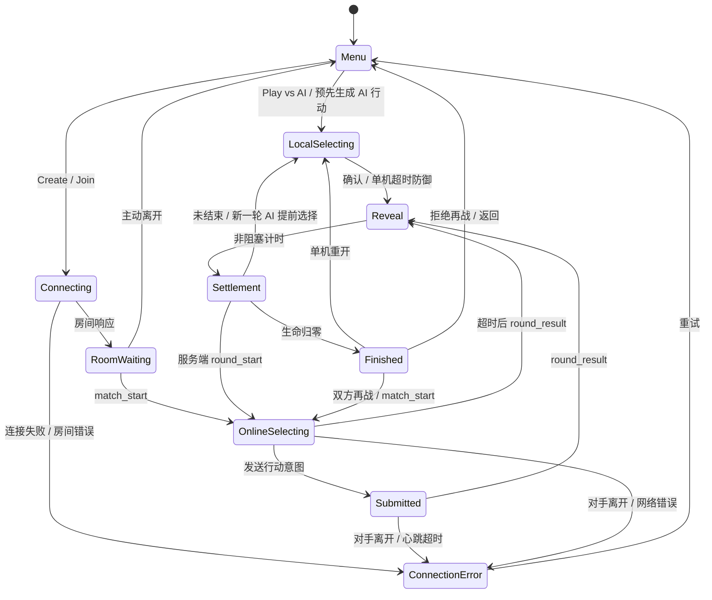
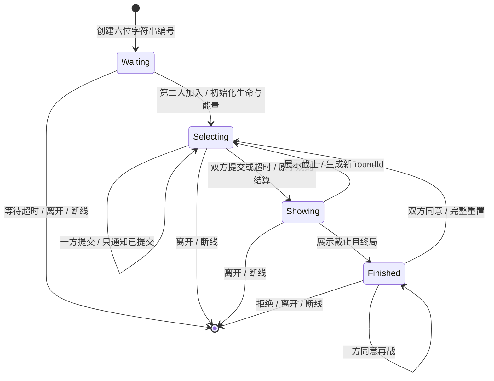
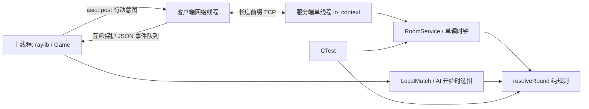

# 状态机与线程

## 客户端

所有游戏页都支持 Esc 返回菜单。网络权威事件可以中断本地动画：下一轮开始前，未展示的上一轮结算会记入日志，然后切换当前轮次。`Finished` 仍等待服务端 `match_finished` 才允许请求再战，避免本地展示时钟提前结束。

## 服务端房间

每轮从 `Selecting` 到 `Showing` 只转换一次；`actions` 是每席一个 optional，写入后不能覆盖。服务端单线程串行处理计时器和 socket 回调；收到合法请求时额外检查当前截止时间，避免晚到请求钻定时器间隔的空隙。超时填充防御沿用同一 `submit` 路径。

`round` 是每场从 1 开始的展示编号；`roundId` 是服务端进程内递增的请求令牌，再战时也不复用，防止旧行动包落入新对局。重开清空行动、同意状态、状态、回合序号和截止时间，再分配新令牌。服务端重启不保留连接或房间。

## 数据与线程边界

所有 raylib API 都位于主线程。网络线程只产生 JSON 事件；主线程每帧 drain 队列。析构时先停止 io_context，再 join 工作线程，最后由 RAII 释放 socket、定时器与处理器。连接读始终只有一个 `async_read` 链；写入始终只有一个 `async_write`，FIFO 保持帧顺序与缓冲区生命周期。

服务端向客户端发消息通过 `asio::post`，避免发送队列溢出同步触发断线时重入房间方法、销毁当前正在访问的房间引用。断线回收先移除房间，再通知剩余连接。每 20ms 处理心跳和房间截止事件，未过期的状态不变化。
